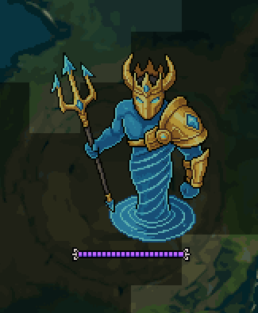
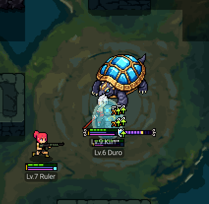

# MLBB Lord & Turtle

An original **Teamfight Manager 2** mod by **Bl0rryFac3**. The Elemental Lord and Turtle take the place of Morgard and Serpen, with custom sprites, animations, portraits, and English objective names.

**Compatibility:** Teamfight Manager 2 v0.7.2, Windows x64, standard map.

## Elemental Lord

- **Neutral fight.** While injured, Lord can slam every eight seconds on the match clock, dealing 100 fixed damage and knocking nearby champions from either team airborne for one second.
- **Win the objective.** The team that secures Lord gets an allied Lord on the next minion wave.
- **Push a lane.** Lord heads for the lane with the fewest surviving enemy towers. He favors the weaker front tower when tower counts tie. He pushes through the outer and inner towers, then clears any base guards protecting the nexus before attacking it.
- **Fight alongside him.** The allied Lord has 6,000 HP, 220 physical attack, 60 armor, and 60 magic resistance. He stays for up to 90 seconds and can be killed by the opposing team. He glides down the lane and swings his trident in combat.

## Turtle

Turtle has its own idle, attack, and defeat animations. Securing it grants the same gold, experience, and permanent team-stat bonuses as Serpen.

## v0.1.16 update

Fixed the slowdown that occurred while a summoned Lord was alive. This version displays Lord’s portrait, and the custom moving minimap marker is disabled.

## Install or roll back

1. Close Teamfight Manager 2.
2. If updating, move your current `mods/mlbb_lord_turtle` folder outside `mods` as a backup.
3. Extract the Windows ZIP and place the `mlbb_lord_turtle` folder in the game’s `mods` directory. Keep one installed copy.
4. Enable the mod and start a fresh match.

To roll back, close the game and restore your backup.
